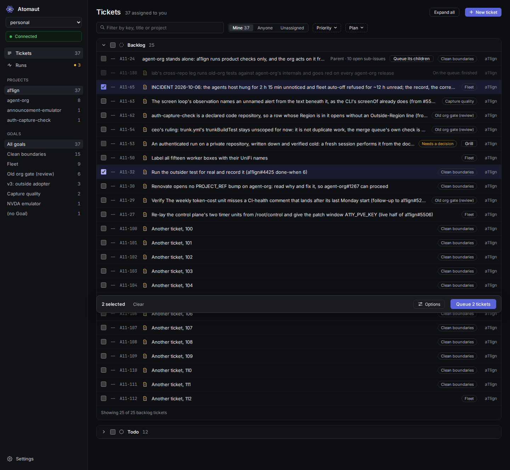
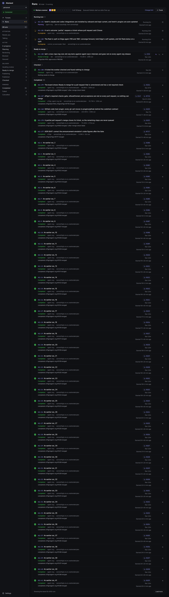
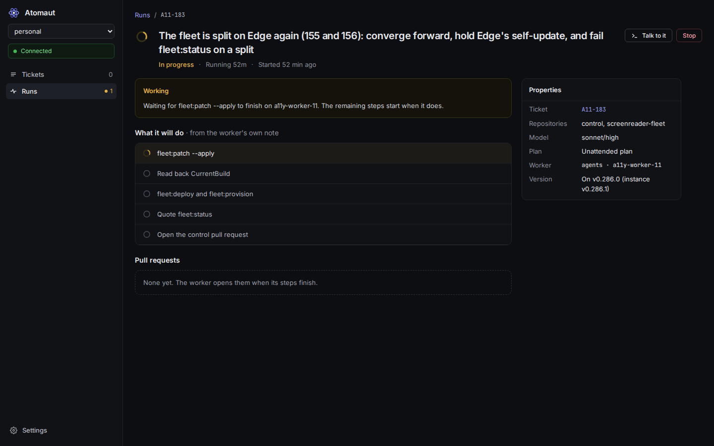
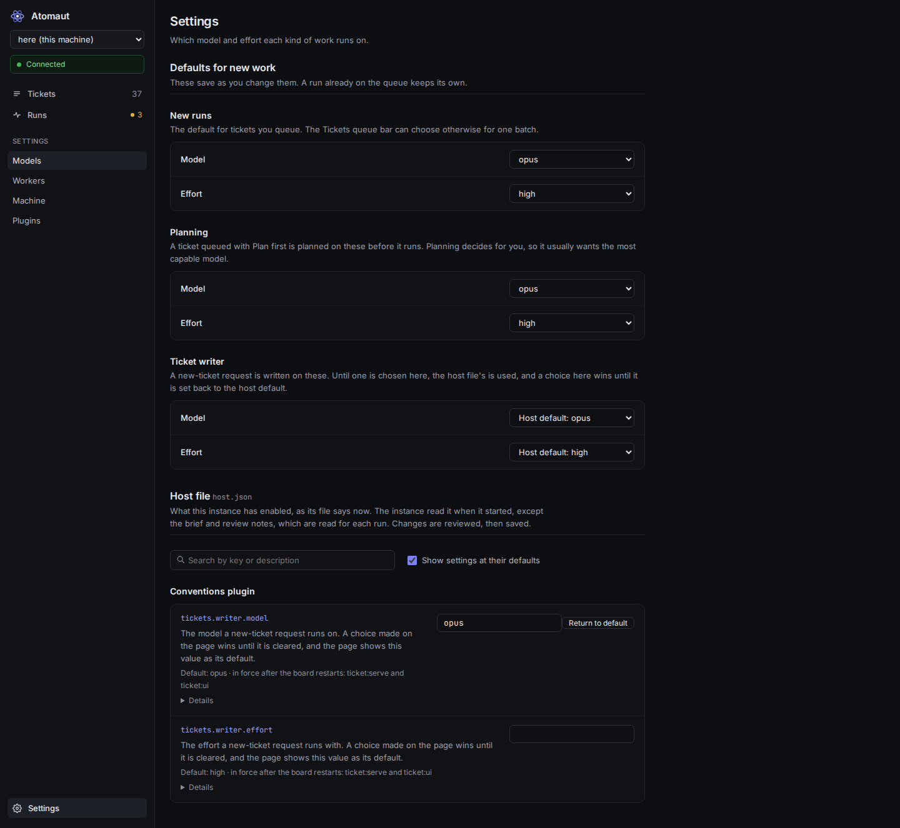

# Ticket mode: a local board that turns the tickets you pick into draft pull requests

[Back to the README](../../README.md). Its settings are in [Configuration](configuration.md), its plugins in [Plugins](plugins.md), and a second machine's board in [Other machines' instances](other-machines.md).

The org (the gate, rows, the board, the reviewer) decides its own work. Ticket mode does not: you pick tickets, and a pool of Claude workers
takes them one each.

## The board

The board is Atomaut: a sidebar with the instance switcher and the connection status, then Tickets, Runs and Settings. These are the pages at 1440px, as `ticket:ui` serves them at `/` (the files are in `ui/captures/`, made by the page checks over a stand-in instance).

| Tickets (`/tickets`) | Runs (`/runs`) |
| --- | --- |
|  |  |
| **Run detail** (`/runs/<key>`) | **Settings** (`/settings/models`) |
|  |  |

An address from the days when the old board lived here still works: `/next/...` redirects to the same address without `/next`, and a link to the old page with `#run-<KEY>`, `#writer-<id>` or `#/settings` lands on the run, Tickets or Settings.

Ticket mode is two services, both on `127.0.0.1`:

- **The instance**, `agent-org ticket:serve`, on `tickets.port` (`4747`). It holds the queue, the pool of workers, herdr, the tracker and the
  `/api/...` routes, and serves no page. It answers only to its key, from `<stateDir>/tickets/board.key`, sent as the `x-ticket-token`
  header. Scripts call it with that key as before. Run one instance per machine.
- **The page**, `agent-org ticket:ui`, on `tickets.uiPort` (`4748`). It serves the board (Atomaut) and holds no queue. It shows each instance
  its connections file names (see "[Other machines' instances](other-machines.md)"), and with no file it shows this machine's. It prints its URL, which
  carries no secret. The browser talks only to it, and it passes the page's calls on to the chosen instance with that instance's key.

- **Pair a browser once.** A browser the page's service has not seen shows a pairing page. Run `agent-org ticket:pair` and type the board's code, which it prints first, into the board page:
  a code works once, within 10 minutes, and five wrong codes spend it. The browser then holds a session of its own, as an HttpOnly cookie,
  for a year and across restarts. The service keeps only the sessions' hashes, in `<stateDir>/tickets/browsers.json`, and deleting that file
  unpairs every browser. The service refuses to start on a file that does not hold sessions, rather than unpair every browser silently.
  Only the board key makes a pairing code. A request that holds it is passed on to no instance, but it can pair a browser, which reaches
  every connection, so whoever holds the key is trusted as you are. The key never goes to a browser, because a browser sends its cookies
  for `127.0.0.1` to every port there. An instance ignores a browser's cookie. Both files are made with mode 600, and a key file another
  user owns or can read is refused.

- **Capture a page of the board.** `agent-org ticket:capture /tickets --size 1280x800 --out <file-or-dir>` starts this checkout's instance and board on two free ports, from a throwaway host file and state folder, pairs a headless browser the way a browser pairs (a code the board mints, traded for a session), opens the route at the size (a path of the board: `/tickets`, `/runs`, `/runs/<key>`, `/settings/models`; `/` lands on Tickets and `/settings` on Models), waits until the page has drawn its heading from the instance's data, writes the PNG, and stops and removes everything it started, whether or not the capture worked. Nothing is signed in with a real account, nothing is uploaded, and a real instance is never touched: the throwaway environment answers herdr's one start question with no workspaces, so no herdr server starts. A capture needs both Chromium builds. `agent-org onboard` installs the browsers as the person who runs it, and the system libraries when it is root or `sudo -n` works; `agent-org doctor` names the command for whatever is missing. A worker is told to capture a page its change alters when `tickets.capture` is true, which onboard sets once both builds start.

- **Pair the worker terminal.** The worker terminal (herdr web ui) has a pairing code of its own. `agent-org ticket:pair` prints it after the
  board's code when the exposure serves the terminal and `tickets.terminal` is this machine's own, and `agent-org ticket:pair --terminal` prints it
  alone (`--board` prints the board's alone). No path is typed: the command runs herdr web ui's own `pair` with the terminal service's
  variables set over this shell's environment. The code works once, within 10 minutes, for one device. If the terminal is not running, the
  command exits 1 and says how to start it, after the board's code is printed. A terminal that another machine serves is paired there, with
  `agent-org ticket:pair --terminal` run on that machine; a served board names it. If the exposure cannot name this machine, the board
  says so, rather than naming another machine.

- **A worker link pairs the terminal for a paired browser.** Following a run's "Open terminal" link, a paired browser goes through the
  page's service, which asks this machine's terminal for a code and opens the terminal with `?pair=<code>` in its address. The page's service
  asks only for a paired browser, only for that connection's own terminal address, and redirects with `Cache-Control: no-store` and
  `Referrer-Policy: no-referrer`. Nothing logs the code. The terminal asks as its own `pair` does: from this machine, over loopback with no
  proxy headers, with herdr web ui's token from its config directory when one is set. Any failure, such as a terminal that is not running,
  a token it refuses, or a route a newer release changed, opens the plain address, and `--terminal` pairs by hand as before. The residual
  risks are that anyone holding the redirected address within its 10 minutes can pair one device, and that asking for a code replaces one
  `--terminal` printed a moment before. Checked against herdr web ui 0.4.11 (`server/devices.ts`, `server/access.ts`, `scripts/plugin.ts`):
  the terminal's own gate decides who may ask, and the board adds no new trust path.

- **On the tailnet, if you serve it.** With the Tailscale exposure (`plugins/tailscale`; `tickets.serve: "tailscale"` is its old key), the page and the terminal are served on your tailnet with
  `tailscale serve`, on `tailnetPorts` (`9443` and `9444`), and never with Funnel. Tailscale decides who can reach the board, and
  pairing still decides which browser may use it. The page accepts this machine's MagicDNS name as its `Host` as well as `127.0.0.1`, and any
  other `Host` is refused as before. The instance is not served and answers only on `127.0.0.1`. The terminal plugin keeps its own access
  rules: the board sets none of them, so a device that reaches the terminal is subject to herdr web ui's settings, not to the board's pairing.
  The board never uses Funnel, and `agent-org stop` removes only the two entries this feature made.

- **Pick.** The open Linear tickets, grouped by status the way Linear shows them, with Select All per group and for the page. An Assignee row
  chooses whose they are: you (the default, so the list starts as it always has), Anyone, Unassigned, or each other person with an open ticket,
  each with its count. Every ticket outside your own list shows its owner on its row, so one is never queued by accident. The choice is not
  remembered: each load starts on the default. A tracker that cannot say whose key it is lists Anyone's tickets, and says why in the row's title.
  An instance from before the Assignee row lists your assigned tickets as it did. A ticket sits under its parent, whatever its own status. A parent folds the tickets under it away, and starts folded.
  Its checkbox picks every ticket under it that is not on the queue, never the parent itself, and shows part ticked when only some are picked.
  A parent that is not yours, such as an epic someone else owns, says so. A ticket Linear says has open sub-issues (not completed, canceled
  or a duplicate, read with the list in the same request) is a parent too, even when none of them is in your list: it is marked "Parent",
  counts them, has no checkbox, and offers Queue its children instead. That queues its open sub-issues, on the footer's model and effort,
  in the order their "blocked by" relations give, or in identifier order where Linear gives none, which the page then says. A sub-issue
  that is itself a parent is left out and named. The instance refuses a parent on `/api/queue` with a 400 saying why, whatever asked, and
  once every sub-issue is done or canceled the ticket is an ordinary one again. Filter by Linear project or priority (several of each at once) or by search, and fold any status group; each is remembered in the
  browser. Labels filter too: each Linear label group among the listed tickets (a parent label, such as a group "Goal" whose labels say what
  each ticket is for) gets a row of its own, named after it, with its labels as chips and their counts, and a "(no Goal)" chip for the
  tickets still without one. The labels in no group share one "Labels" row, shown only when there are any. A row works like the projects:
  All clears it, several chips show a ticket with any of them, and rows combine with each other and every other filter. The labels are read
  in the same request as the list, the choice is remembered in the browser, and each ticket shows its group labels as small tags after its title. On a machine that sets `tickets.plan`, a ticket with no plan of its own is marked, so you can attach one before a worker starts it.
  The mark is muted when the ticket's parent has a plan, because a worker is briefed with its parent's plan too. An epic is never marked or
  counted, because no worker starts one. A Plan filter, also remembered, shows only the tickets with a plan, or only those without, each
  under its epic. Queue runs them on the model and effort the footer shows, which start as the default set in Settings. Changing them in
  the footer applies to that batch only: the default stays as it is, runs already queued keep their own, and the next batch starts from
  the default again. You do not choose a repository: the worker does.
- **Planned first.** On a machine that sets `tickets.planner`, the footer offers Plan first whenever a selected ticket has no plan of its
  own, and Queue says how many it will plan. Each such ticket's first run is a planning run, on the planning model and effort set in
  Settings, apart from the run's. It plans and changes no code, and the hook refuses it a commit, a push, a worktree and a pull request.
  When it writes `planned`, the board attaches the files it left to the ticket and moves an unstarted ticket to the planner's state. The
  ticket then goes back on the queue where it was, and its run is told the plan was not agreed with a person, so its pull request lists
  each decision the plan made for you. A plan the tracker will not take ends the run for you, with its files kept.
- **A plan follows the ticket's text, and a worker is told when it changes.** Every brief says when the board read the ticket and when the tracker
  last changed it, above the text, and a worker's pull request body says which version it worked against (`Worked against the ticket as updated
  <time>`). When the board attaches a plan it writes a `## Planned against` section into it, before `## Paths`: the ticket's `updatedAt`, the
  sha256 of its description, the files attached with the plan and the description as planned. If the description no longer has that hash when the
  run is queued (the tracker moves `updatedAt` on every state move, so the hash is compared, not the time), the run says "ticket changed since
  plan, re-planning first" with a "What changed" link that opens the description with the old lines struck and the new added, and, as it starts,
  the board copies the stale plan and the files its stamp lists for the planner, detaches them from the ticket (a person's own attachments stay),
  and plans again on the model and effort the ticket was first planned with ("planning (ticket changed)"). A plan with no stamp, such as one a
  person attached, is never re-planned. A change while a worker runs is sent to it as a message naming a file with the new text and the lines that
  differ ("ticket changed: sent to the worker at 14:05"), and the next round's brief carries the new text and what changed since the last. A
  planning run is not sent a message: its stamp holds the text it started on, so it plans again once its plan is attached.
- **A dependent learns from its blockers' merged pull requests.** When a blocker's pull request merges, the code host reads its title, its body and
  the markdown sections its diff added (`readMergedFindings`), the board saves them under the dependent's folder (`blockers/`), and the dependent's
  queued run says "learns from A11-165 (#3 merged)", linked to the pull request. A planner is given the files and must write a `## What the
  blockers found` section naming each pull request by its address and saying how its findings apply or why they do not; a plan that leaves one
  out is refused. A dependent planned before the merge is planned again with the findings before it starts, and a worker queued with no planning
  has the files named in its brief.
- **Queued together, planned together.** When `tickets.planner.run` names `{keys}`, the tickets one press of Queue plans first are one
  batch, and one planning run plans them, at most 8 to a run: a larger batch splits into runs of 8, in queue order. Tickets queued at
  different times are never batched. Every ticket of the batch shows as Planning, all linking to the run's one terminal, and the batch holds
  one worker slot. The run writes a folder per ticket in its plan folder, holding that ticket's plan files or a `QUESTION.md`, and an
  `order.json` giving each ticket's repository and the tickets of the batch it waits on. When it writes `planned`, each ticket with plan
  files has them attached and is queued again to be worked. A ticket with a question, or with nothing, ends as Needs you, and the others
  carry on: the run keeps its terminal open for the tickets it handed back (parked), and each of their cards says "Planned together with A, B, C: answer in the batch's terminal"
  and links to that one terminal. The person answers there, and when the run writes `planned` again the tickets it still holds are settled the same way, the order read against
  every ticket the batch was planned with. The board records the order in the tracker as "blocks" relations, so a ticket that waits on another shows as Blocked until it
  is done. An order that names a ticket outside the batch, a ticket waiting on itself or a cycle records no relation, and the board's log
  says why. A run that ends any other way ends every ticket of the batch that way. Stop on any ticket stops the whole run, and Retry plans
  a ticket again on its own.
- **Board.** Every run in one list, newest activity first, each with a status icon after GitHub's Actions runs, and a filter per status
  with its count: Needs you, Talking, In progress, Waiting (a run parked on a wait its worker declared, or on background work: it names what it waits on and until when), Planning, Reviewing, Blocked, Queued, Awaiting review, Ready to merge, Publishing, Published, Completed, Failed and Cancelled. **Ready to merge** is a pull request GitHub would merge as far as its review and its checks go (A11-179): every open pull request of the run is approved at its current head (by the board's reviewer or a person, and GitHub's own review decision does not still ask for a review or for changes), and its required checks are green there. A run whose feedback round ended `reviewed` that is not there yet reads **Awaiting review**, with its outcome still `reviewed`, and its card says what it waits on, in this order: `review: none yet at 58848c34` (or `changes requested at 58848c34`), `checks red: gate`, `checks not passed: gate`, and `not read yet` until a watch has read its pull requests; with more than one open pull request each is named by its address. A run is Completed once the tracker
  completes its ticket, or once its pull requests have merged, as Linear's GitHub integration reports them. Linear completes a ticket on a
  merge only where its team's workflow says so. A run whose pull requests all closed unmerged is Cancelled. The board asks every two minutes. A run can be removed
  while queued, stopped while running, and retried once it has failed. The number of workers at once is set in Settings, and a change takes effect straight away. On a machine
  that sets `tickets.terminal`, a live or parked run has an Open terminal link to its agent's terminal in the browser. A run whose worker wrote `done` is Completed too: the board moves its ticket to the tracker's completed state and posts the worker's reason and evidence on it (see Outcomes below). A Completed run whose pull requests merged says `completed: a11ign/agent-org #1815, a11ign/plugin #9 merged` on its card, whether their bodies said `Closes` or `Refs`. When its ticket's Done-when has After-merge lines, the board lists them on the run and under "After-merge checks" beside "Pull requests", posts them once as a comment on the ticket, and the card adds `; 2 after-merge checks listed`: such a run is Completed, never Needs you. Each line is then a check of its own (A11-277), kept in `<stateDir>/tickets/after-merge-checks.json` as `<KEY>#<n>` (its place in the run's list), so it outlives the run's dismissal. The line's owner is read from it in the first form that fits: a prefix (`Chairman session: …`, `The chairman: …`, `On the agents host: …`, `The release manager: …`), a subject (`The chairman's session moves …`, `The chairman chooses …`), or A11-173's trailing clause (`<check>. The chairman, after merge.`), each of at most 6 words and 40 characters; a line none fits says "owner not named". **The org verifies its own work (A11-302).** The owner no longer decides who runs the check, and the person's session is no runner: a check's runner is `board`, `agent` or `person`, and the plan names it. A line no plan names a runner for is an `agent` check. A `person` check needs an item of the escalation list and waits under "Needs you"; it is the only kind the Runs page's "After-merge checks" list (`GET /api/queue`'s `afterMergeChecks`) shows, oldest first, with "Failed: follow-up?" over the ones the person closed failed whose follow-up is undecided. The org's own checks are on their ticket's Run detail (`GET /api/queue/<KEY>`'s `afterMergeChecks`, every runner and state), and the pool bar counts the open ones older than three days and outside their watched window (`afterMergeOrg: { open, stale }`). `GET /api/after-merge/audit` answers `{ ok, unmigrated, stale }`: the open checks still on the retired runner, and the org's past three days outside their window. A runner closes a check with `POST /api/after-merge/<KEY>/<n>` and `{ "result": "passed" | "failed" | "superseded", "evidence": "<one line, at most 300 characters>", "by": "agent" | "person" }` (the Runs page's Passed, Failed and Superseded, for the person's own; a verifier run's result for an agent's): the row leaves at once, a second close is answered 409 naming how it closed, and the next tracker sweep posts `After-merge check <result>: <line>`, the evidence (or `Reason:`) and who closed it on the ticket, once, trying a failed post again at the next sweep. A close by `session` or `board` is refused with 400: the board closes its own checks in its sweep. A failed close answers with its follow-up request pre-filled, and `POST /api/after-merge/<KEY>/<n>/follow-up` with `{ "writer": "<writer request id>" | null }` records the follow-up (the Runs page's "File a follow-up" opens the New ticket dialog with it, and "No follow-up"). The board files the follow-up of a failed `board` or `agent` check itself, as a quick ticket-writer request with the same text, and records its id; a machine with no `tickets.writer` leaves it undecided and says so in the log. A closed check is kept 30 days after no run lists it. A plan names each After-merge line's runner in a `## After-merge checks` section, one bullet per line (the line quoted, then `- Runner: board | agent | person`, `- Escalation: <id>` for a `person` check, `- Observe: <spec>`, `- Pass: absent | present` and `- Window: <30m | 6h | 7d>` for a `board` check (`- Window:` alone is also an `agent` check's delay after release), and `- Evidence: <one line, at most 200 characters>`), and the board refuses to attach a plan that leaves out any After-merge line, quotes a line the ticket does not hold under After merge (or move there), names a runner other than the three (`session` is refused, and so is any field that names the chairman's session), gives a `person` check no escalation item on the list, or gives a `board` check no known spec. A refusal of that section is not Needs you (A11-288): the board prompts the planner's own pane with the refusal and the exact format (`after-merge-refused-<n>.md` in the run's folder), up to 2 times, and a third refusal is handed to the person's session as a `session` wait (24 hours), never to the chairman; a ticket line is matched against the plan's copy with quotes, backticks and white space normalised. The sweep reads the section from the attached plan when it copies a line, so the check takes the plan's runner. **A `board` check** is watched by the board. Four specs are an event that has to happen, and only ever pass the check: `sweep-ticket [<repo>:<package>]` (the dependency sweep files a ticket it had not filed when the board began to watch), `review <pull request URL>` (a review stands on the pull request's head), `queue-merge <owner/repo>` (a run's pull request there merges with no answer, Respond, approval or talk on the run) and `wake [fleetJob|ciRun|pullRequest|ticket]` (the board wakes a worker on its declared wait); one the board did not see in 7 days is handed to an agent. Five specs are a window over one source, each with `Pass: absent | present` and `Window: <30m | 6h | 7d>` (31 days at most): `run-log <event kind> [<text>]` (the run log: an event of that kind, optionally naming the text), `merge-queue <owner/repo> [<failed job>]` (a removal of a pull request there from the merge queue, as the board recorded it on its runs), `ci-history <owner/repo> <workflow> [<branch>]` (a failed run of the workflow on the branch, `main` when none is named, as the code host reads it), `doctor <host> <check>` (a line of the host's doctor, failing for `absent` and passing for `present`; only the board's own host can be read) and `release-assets <owner/repo> <asset> [<count>]` (the next `count` releases each carry the asset; the first one without it is the breach; `Pass: present`). An `absent` window passes when it closes clean, and fails on the FIRST breach, with the event in its evidence; a `present` window passes on the first sighting. A window that closes with nothing seen for `present`, or that could not read its source (no reader on this host, an unreadable doctor), is never a clean window: the check is handed to an agent. A window begins when the ticket's change is in a release installed on this host (the tool folder holds the pull request's `.acceptance` file; a change merged into another repository counts after an hour), and an event from before it is no breach. **An `agent` check** is run by a verifier run: once its change is installed, the board starts a short run on Sonnet (a writer run in `verify` mode, with its own 30-minute limit, that files no ticket and is not listed as a new-ticket request) that carries the check's line and its `Evidence:` spec, does what the line says, and ends on `{ "kind": "passed" | "failed" | "superseded", "evidence": "<one line>" }`; the board closes the check with it through the route above. **A check about a delay after release (A11-361)** (`- Window:` alone on an `agent` check, or, when the plan gives none, a line that says "7 days after release", "over 7 days" or "for a week") is not given to a run before its window ends: it is due that long after its change first reads as installed, the ticket's Run detail says "due <date>", and it is never failed for being early. **A check this host cannot run (A11-361)** ends the run on `{ "kind": "cannot-run-here", "needs": "<one capability, such as chairman-mac>", "evidence": "<one line>" }`: the check stays open and is not failed, the board routes it to a runner that has the capability (none exists yet) or files ONE ticket for the capability ("Runner needed: <capability>"), however many checks need it, and no ticket for the check. A run that ends with no usable result is tried once more, and then the check is closed failed, saying how the last ended. At most two check runs are unfinished at once. **The one-time migration (A11-302):** every open check still on the retired `session` runner, or a `person` one naming no item of the list, is re-read by a planner pass (a writer run in `migrate` mode, ten checks at a time, at most two passes for a check) that rewrites it as a `board` or an `agent` check, keeps it the person's with an item, or marks it superseded with a reason; its entries are held to the plan check's rules, and a check the pass did not answer is given to an agent. A `person` check on an escalation item waits under "Needs you" at the top of the After-merge list, with the item's label; one still open 7 days after the sweep first showed it is marked overdue once, never again, and the row says "overdue". The session's queue (`GET /api/session-asks`) lists no After-merge check.
- **The board reads again when you come back, and an update's restart is not an error (A11-211).** The page reads the queue and the new-ticket requests every 5 s, and the moment its tab is shown again or its window is focused, whatever it was waiting for, so a tab left open comes back to current state and every Open terminal link points at the pane its run has now. It does not load the whole board again then, so what you ticked and the Assignee scope stay. A read that gets no answer (connection refused, a network error) or a 502 or 503 from a proxy is an instance or a service restarting, as `agent-org update` does for 10 to 30 s: the page shows a quiet "Reconnecting…" line instead of the red message, tries again after 2 s, 4 s, 8 s ... up to 60 s, and clears the line by itself on the first good read. Red is for an error the server answered with, and for a press (Queue, Pause, Talk ...) that got no answer, which is not retried. A page opened during the restart finishes loading by itself. A click on an Open terminal link when the board was read more than 5 s ago opens the tab and reads the run's pane again first, so it goes to the live pane (or closes when the run is over). An SSH remote its proxy cannot reach is still its own red message.
- **Parked, not closed, when a run needs you.** A run that ends `needs-human`, `wrong-repo` or with no outcome keeps its herdr workspace
  and holds no slot, so you can answer the agent in its terminal. Once the agent works again the run is In progress again, its old outcome
  is marked stale (`outcome-stale-before`, the time the run parked) and not moved, so the worker must write a new one before it stops: the stop hook
  reads the outcome once and judges it as no outcome while it is not newer than that mark (A11-152). A worker that writes a new outcome file after its
  run parked, even between two of the board's looks, ends the run on it once its agent is idle. The stop hook refuses an outcome file that does not
  match the contract and names the field it wants (`ready-pr needs prs: [{repo, url}], you wrote pr`), so the worker fixes it in the same turn. A
  finished run whose outcome file was unreadable is read again when the file changes, so a corrected file ends it without a Dismiss. Close shuts a
  parked run's workspace and keeps its outcome, and a parked run is retried only once it is closed.
- **The ticket goes back when its run ends without a pull request.** When a run moves its ticket to `tickets.workingState`, the board keeps the
  state the ticket came from on the run. A run that is stopped, crashes or checks its ticket, or a queued run that is removed, puts the ticket
  back in that state. A run that ends `needs-human`, `wrong-repo` or with no outcome keeps the ticket In Progress while it is parked, and Dismiss
  puts it back, but Close does not. A run that opened a pull request is never put back: the tracker's own integration moves its ticket from there.
  A person who has moved the ticket since is left to it, and the record goes. A restore the tracker refuses is logged, and the board tries it again
  on its next refresh, while Remove and Dismiss say why and leave the run where it is.
- **Still working, not Needs you, while a worker's own background work runs.** A worker that ends a turn while a shell, a Monitor or a task
  of its own is still running and will wake it (a long Ansible run, say) writes `{ "kind": "working", "reason": "..." }`. The run stays In
  progress, holding its slot, with that reason as its note, and the outcome it writes when its work wakes it replaces the note and ends the
  run as usual. The stop hook lets one stop through on a `working` outcome and refuses a later stop on the same file, so a woken worker says
  how the run stands, or writes `working` again. Before a long wait a worker writes `{ "kind": "working", "reason": "...", "waitingOn": "<what>",
  "until": "<ISO time>" }`. A run whose pane shows a running shell or Monitor, or whose note names a `waitingOn`, is not marked Stalled while it
  waits: its row reads "Waiting on background work for 54 min: <what>" until `until`, or until 3 hours after the outcome was written when there is
  no `until`; then the worker is prompted once, and with no newer outcome `tickets.stallMinutes` later it reads Stalled and names the job. A worker
  that waits on a fleet job, a CI run, a pull request or a ticket writes `waitingOn` as a list of those events instead and ends its turn: the board
  reads them and prompts the worker once when all have finished or any has failed, and the row reads "Waiting on fleet job fj-1 (4 of 6 pages, about
  20 min)" (see [docs/wake-on-event.md](../../docs/wake-on-event.md)). A fifth event is an ask only the person's session can do (A11-275): `{ "session": "<the exact command, where it runs, and what a pass looks like>" }`
  (at most 1,000 characters, with no `until` of its own). The run waits as for any other event, In progress and never Needs you, and its row reads "Waiting on the person's session: <ask> (asked, no answer yet)".
  The ask is in the session's queue, `GET /api/session-asks`, as `{ "kind": "waiting-run", "key", "url", "pullRequests", "ask", "sentAt", "answer" }` (`sentAt` is when the worker declared it, nothing is written by listing it, and `?since=<at>` does not hide one: every ask not yet answered is listed,
  oldest first; no After-merge check is, A11-302); the session answers with `POST /api/session-asks/<KEY>/answer` and `{ "ask": "<the ask, as listed>", "result": "<what it saw, at most 4,000 characters>" }`
  (404 when the board has no such run, 409 when the run is not waiting on that ask; the same answer again changes nothing). The result is kept in `<stateDir>/tickets/session-answers.json`, finishes the wait at the board's next
  read, and is in the prompt that wakes the worker. The wait is never failed and never late on its own: the worker's `until` bounds it, and a worker woken at `until` with no answer declares it again. Any other agent idle with no newer outcome for
  `tickets.stallMinutes` is marked Stalled on its row, with the note: the run is not ended and the agent is not prompted. `working` is never for a
  question: that is `needs-human`.
- **Approve, once you have reviewed the drafts.** A run Awaiting review offers Approve. It queues the ticket again
  as a review run, which resumes the worker that wrote the code in its own Claude session: the board saves it when a run ends, and for an
  older run takes the newest session Claude Code kept for the ticket's folder, starting a fresh worker only when there is none. The review run
  marks each pull request ready, which only a review run may do, fixes and answers what is on them, pushes, and ends at the push (A11-306): it does not
  wait for the checks or the review, which the board watches. It ends `reviewed` once the findings are answered and pushed; the board then shows it Ready to merge only once its pull requests are approved at their head and green there, and Awaiting review until they are (see "Board" above). `tickets.review` says
  what a review is on this machine.
- **A worker ends its round at the push (A11-306).** The first run and every round push, write the outcome and end: `gh pr checks … --watch`, `gh run watch` and a `sleep` over 60 seconds are refused by the Bash hook, which says the board wakes the run. A run held open for them waited 10 to 25 minutes in-session. The board wakes the run on a red required check (a failure the infrastructure caused is rerun first, A11-300) and on review feedback, as the next bullet says, and starts the reviewer for a head with no review within 2 minutes of its required checks going green: a pass that does only that, starting the first review of a green head, runs every minute, where the rest of the watch is every 3. The watch logs, for each first review, how long after the checks were first read green the reviewer started, and says so when that is past 2 minutes. The Stop hook is as it was: it still refuses an outcome naming a head that is not pushed.
- **Watched once it ends reviewed, and answered on its own.** Every 3 minutes the board reads the open pull requests of each run that ended `reviewed` (Ready to merge, or Awaiting review until its
  pull requests are approved and green: it is read again until it merges, or it could never become ready), and of each run Published. Each read records, for each pull request, its head, its review at that head, its red required checks and its required checks still running, which is what the card's status and its "waiting on" line are made of. A review that comments or requests changes, a conversation comment or an inline comment newer than the run's last round, from
  anyone but the GitHub account the workers use (`gh api user`), queues another review round. So does a check that is red at the head commit
  (the required checks, or every check where none is required), **once for each head**: the round's brief names each failing check and the error lines of its job's
  log, the jobs behind a failed required `gate` in its place, and a head that stays red after its round, or after a restart, starts no second one (A11-154).
  The same red check also wakes a run that ended needs-human, with no outcome, or crashed, or that is parked on a question, when its pull request is still open: its workspace
  is closed first, as for a conflict. A check that failed for an infrastructure reason (a runner that was lost, a rate limit, a GitHub 5xx or a network error) is not handed to a worker: its
  failed jobs are rerun once for the head, the run says so ("Reran test on 1a2b3c4d: a runner was lost or a rate limit was hit"), and red again on that head it is named for a person. **A red check that is not the run's starts no round** (A11-179): a check that is also failing on the head of the repository's default branch, or on another run's open pull request in the same repository that changes none of the run's plan paths, is named on the card ("refusalOwners is red on main / not this run's; owned by A11-127") and is neither briefed nor rerun, because no diff in the run's region can change it. The owner is the ticket a `Blocked-by:` line of the pull request's body names, else the key of the run's team that the check's own refusal text names, never the run's own. It is read again from fresh reads on every watch, so a check main has since fixed is the run's again and gets its round; a head with some of each is a round for the run's checks, and its brief says the others are not the run's. The pull request is still not Ready to merge while such a check is red there. The round
  resumes the same worker, names what started it, and has
  the worker fix what is right with a test, answer what is wrong with evidence, push, and end at the push (A11-306). The board starts at most 3 such
  rounds. The next trigger hands the run to you as Needs you, whatever its outcome was, saying its pull requests keep getting feedback. Feedback that arrived while a
  round was running is not answered twice. Merged or closed pull requests are never watched.
- **A stacked pull request is retargeted when its base merges.** A run stacked on a blocker's pull request keeps that pull request's branch as its
  base. When the blocker merges and its branch is not deleted, GitHub does not retarget the stacked one, so the board does it: every 3 minutes it
  moves an open pull request whose base was the head of a merged pull request to the repository's default branch (`gh pr edit --base`), reads the
  base back, and leaves the head as the worker pushed it. A base whose branch is gone with nothing merged on it is not moved, since its work may
  never have landed: the run says `Needs retarget` on the board, with the pull request and the branch, until a person retargets it. A retarget that
  is refused is said the same way, and tried again on the next sweep.
- **A Dependabot major, or a group that stays red, becomes a ticket (A11-255).** Every 3 minutes the board lists the open pull requests the dependency bot (`dependabot[bot]`) opened in the repositories it serves, by their author, never by a title anyone could copy. A major update (an ungrouped `bump <package> from <a> to <b>` whose semver major differs; a `0.x` minor is not one, and neither is an Actions sha move) is asked of the ticket writer once for each repository, package and major, so a later pull request for the same major is not a second ticket. A grouped update whose required checks fail, with none pending, has its failed jobs rerun once for that head; red again at the same head, it is asked for once, naming each failing job and its error lines. The request goes through the writer path (`queueWriter`, a quick run of the create-ticket skill, never a worker) and is built from fields the board parsed itself: the package, the versions, the addresses, the branch and the log's error lines quoted as data, and from the pull request's body only a changelog link on github.com that matches whole, and none of the rest of its text. When the run ends with exactly one ticket and no failure, the board queues that ticket as Queue does. It keeps what it asked in `dependency-tickets.json` beside `queue.json`, replaced whole by rename: to let a ticket be requested again, delete its key from `tickets` (a key is `<owner/name>:<package>@<major>` or `<owner/name>#<number>@<head>`). A run that made no ticket is asked again after an hour, up to three runs, and then waits for a person. The sweep asks for nothing while the queue is paused, and leaves one of the three new-ticket places to a person. Every request carries its team (A11-267): the team of the epic A11-251, read from the tracker each sweep, set on the writer run and named in the request's text, so the writer never infers it; while the epic cannot be read, or names no team, the sweep says why once and asks for nothing. A new-ticket run takes its team from one fixed, ordered rule in its brief: the request's own team (else the parent the form names), then the team `tickets.pick` names, then the workspace's only team, and it ends needs-human only when none is left. The Stop hook judges a new-ticket run by the writer's own outcomes (`created`, `decided`, `needs-human`), and a ticket worker still cannot end on `created`. It needs the code host to implement `openDependencyPulls` (contract 1.19) and `tickets.writer` to be set; without either it says so and files nothing.
- **Respond to review, for any run with a pull request open.** A finished run whose ticket the tracker has not completed or canceled, and that has a pull request open, offers
  Respond to review, whatever its outcome was: Ready to merge, Published, handed back after the board's 3 rounds, needs-human, crashed or ended with no outcome. A parked run's
  workspace is closed first. It queues a review round straight away, resuming the same worker, told that you asked it to answer the current
  feedback: reviews, comments and failing checks. It starts the count of the board's own rounds again, so watching carries on after it. On a run whose pull requests are drafts it acts as
  Approve. A press that cannot act says why on the board: the run has no pull request open, its ticket is completed or canceled, it is still running, or a round is queued already (A11-154).
  A run the board handed back at its cap because its pull request conflicts with its base merges that base in first, keeping both
  changes, and never rebases or force-pushes (A11-125).
- **A round and a Talk never share a session.** A Talk is refused while a round of the run is queued or running. Talk on a run that has a Talk session already (queued, running or
  waiting for you in its terminal) changes nothing, and the page opens the browser tab named for that run, so a second press finds the same pane. A batch is one run: Talk on any of its
  tickets opens one pane for all of them, and every card shows Talking, never Planning. A parked run's pane is never closed as a leftover, whatever else is queued: a queued round or Talk
  waits, saying "Waits for the person to answer in <workspace>", until the person answers or closes it. A queued round or Talk waits, saying "Waits for the Talk session in
  <workspace> to end", while an agent that is working holds the run's Claude session or its herdr name; an agent that is idle, done or has no pane is the run's leftover, and its workspace is
  closed first, said in the log and on the run. A parked run herdr no longer lists has its workspace closed as it is unparked (A11-154).
- **Publish, once a run is Ready to merge.** On a machine that sets `tickets.publish`, each run Ready to merge has a Publish tick, and
  "Publish selected (N)" publishes every ticked run in one press. Nothing else can be ticked: nothing reaches a channel before you approved it
  and it passed its review and checks, and a Published run is never posted twice. The press starts one publish run, in its own folder
  `<stateDir>/tickets/publish/<id>`, holding one slot, on `tickets.publish.model` and `effort`. It starts even while workers are paused,
  because you just asked for it. While it works, each run it posts shows Publishing, with the spinning ring and, on a machine that sets
  `tickets.terminal`, an Open terminal link to the publish run's own terminal. It writes `published.json`, `{ "links": ["<message url>"] }`, and the outcome `published`. Each run it
  posted then shows Published, with a link to the first message, stays watched, and still turns Completed when its pull requests merge. A
  publish run that fails, or takes over 30 minutes, leaves its runs Ready to merge, and the Board says why.
  **A machine where people review publishes earlier**, with `tickets.providers.publish.when: "awaiting-review"` (`agent-org plugin config slack when=awaiting-review`): there the post is how a
  reviewer finds the pull request, so waiting for an approval would never end. A run out of draft (`reviewed` or `ready-pr`) can then be ticked once every open pull request was read at its head and waits
  on its review and nothing else, with no required check red or running; a draft and a run not read yet cannot. Once posted it reads Published, as a run published at Ready to merge does, and it stays
  watched for feedback. Absent, `when` is `ready-to-merge`, which is the behaviour above.
- **New ticket, written from a request.** On a machine that sets `tickets.writer`, the Pick view has a New ticket button. You say what the
  ticket is for, in plain words, and choose its placement. Auto (the default) leaves the project, repository, goal, priority and parent to the
  writer, which picks each from your request. Manual lets you set any of the five, and the writer uses what you set as given and picks the rest;
  a choice left "Not set" is the writer's, and "No priority" is a choice. `POST /api/writer` takes `placement` (`"auto"` or `"manual"`); a body
  that names none is Manual when it names any of the five and Auto when it names none, and an Auto body that names one is refused. Quick (the default) runs unattended:
  the writer runs the `a11ign:create-ticket` skill in full, which grills itself, writes the plan with a "Decisions made without a person"
  section, and files the ticket with its plan attached. Grill runs the same skill with you, in a terminal the board opens, asking its questions
  there, one at a time; it needs `tickets.terminal`. When a Grill run asks a question, its card shows "Waiting for you" with the question, keeps
  its terminal open until you answer there, and resumes; it fails only when its agent exits, or when nobody answers for 4 hours. The run files
  its own tickets: the tracker's create tool and the two attachment tools are granted to that run alone, and a hook refuses any call that
  updates, closes or deletes an existing ticket, names a relation on another ticket (`blocks`), attaches to a ticket the run did not create,
  or creates an eleventh. The hook records each ticket as the tracker returns it, and the board checks the run's outcome against that record,
  reads each ticket back from the tracker, and shows it as a link. A run that fails says why, and keeps any ticket it made before it failed.
  A build worker is refused every filing tool by name, and the refusal says to use New ticket. The writer's model and effort are set in
  Settings, apart from the run's and the planner's, and `tickets.writer.model` and `.effort` stay the defaults until one is chosen there. It
  works on a ticket-only host, and through a remote connection or the tailnet-served board as the rest of the board does. A request is refused
  by name when it is empty or too long, names a placement other than Auto or Manual, names a choice under Auto, names a repository the machine
  does not have, or a parent that does not exist. At most three new-ticket requests are unfinished at once. A request still under way is a card on the Tickets page with Open terminal and Stop. A finished one (Done or Failed) is a notification in the panel behind the bell in the sidebar's head, on every page (A11-383): it lists what the request filed or why it failed, and is cleared one at a time (`POST /api/writer/<id>/dismiss`) or all at once (`POST /api/writer/dismiss-finished`, which leaves requests still under way). One that finishes while a page is open opens the panel, marked New, without taking the focus.
- **Blocked until what blocks it is done.** A queued run whose ticket the tracker marks "blocked by" another waits, as Blocked, naming what
  it waits on, and holds no slot, while a run queued after it with nothing blocking it starts first. A blocker lets go once the tracker
  completes it, once its run on the queue is Completed, or once its pull requests have merged, whatever state its ticket is in (a pull request that says `Refs` leaves the ticket In
  Progress). A canceled or duplicate blocker never lets go, so a person decides. The blockers are read before a run first starts, and nothing starts while the tracker
  cannot say; they are read again every two minutes, so a relation changed in the tracker counts. A run that waited names its blockers and
  their pull requests in its brief, and checks that any release it depends on is out before relying on it. A run whose plan cannot be
  downloaded waits, saying why, and the board asks again on every pass; the other runs start, and it takes no slot (A11-125).
- **Stacked on a run it overlaps, not held (A11-374).** A queued run whose files overlap a run in its repository that has an open pull request, or a branch the board read as pushed, starts at once, branched from that run's branch, with its
  pull request based on that branch; A11-248's restack moves the stack onto the default branch as each pull request below it merges, and the arm bot merges it bottom first. Its card says why: "Stacked on A11-196 #12 (overlaps `src/pool.ts`)". What a run
  claims is, in this order, the paths its plan declares, the files of its open pull requests, the paths its ticket's `## Region` names, and, when it has none of these, its whole repository (the card reads "same repository, files not known"): a run at work
  with no files known holds its whole repository, so a ticket queued without a plan is not treated as overlapping nothing. A run that overlaps two open stacks stacks on the one most recently updated, and its brief names the other's branch. Against a run that has pushed
  no branch yet it waits ("Waits for A11-196 to push its branch"). The rest of this item is the wait a run has where no stack is possible (no repository is known for it):
- **Held back by an overlap.** A queued run whose plan declares a path another run holds waits, as Blocked, saying which run it waits on
  and every path both touch, such as "Waits on A11-196 #12: both touch ui/src/shell/App.tsx, ui/test/fixtures.ts". When every path is only a
  directory claim and no file is shared, the line adds whose directory to narrow: "a folder claim, not a shared file: narrow A11-196's `ui/test/` in its plan" (A11-212). A run holds the paths its plan declares, and the files its open pull requests change, from the moment it ends.
  Its plan's `## Paths` section lists those paths, `<repo>:<path>` bullets; `pr:open` reads the same section as the Region its pull
  request is checked against. A pull request whose files are not read yet holds its whole repository until a watch reads them.
  A run on one step of a multi-step plan (A11-175) holds that step's paths and its open pull requests' files, not the whole plan's: a plan
  gives each step a `### Step <N> of <M>: <title>` section that ends with its own path bullets, and the run's step is the one its
  `Partial:` line names, else the one after the last merged. A step whose section lists no paths (a plan that numbers its steps as table rows) holds only its open
  pull requests' files once its worker has ended, and the whole plan's paths while it is running or has no pull request open. A queued later step
  contests only its own step's paths. A reviewer of a pull request whose body says `Partial: step N of M` is given that step's section
  of the plan, told to hold the pull request to the ratchets' direction (a baseline or allow-list only shrinks, a rule or check only
  tightens), and shown the ticket's Done-when as the last step's.
- **Planned to run side by side (A11-212).** A planning brief lists the paths every other queued and running ticket holds, grouped by repository, and asks for the narrowest claim that
  holds the change: files, or a folder only this ticket writes into, never a repository's whole `test/` or `captures/`. It asks the plan to avoid the held paths where the design allows
  (per-feature folders, per-feature test data beside its tests, no edit to a registration point another ticket prepared), to say under `## Overlaps that remain` which ones it still shares
  and why, to name a shared integration point (a route table, a registry, a fixtures file) in the plan of the ticket that first creates it, and to prepare it with per-feature entries or
  placeholders. A batch's `order.json` orders a ticket `after` another only when it needs that ticket's code or both change one file. A plan that claims a directory another queued or
  running ticket also writes into is sent back once by the planner's Stop hook, naming the narrower paths, and refused on the board as Needs you when it still does. A file claim is never
  refused: two tickets that name one file share it, and the overlap wait puts them in turn. The list is written beside the brief (`claims-given.json`) so the brief, the hook and the board judge
  the plan against what the planner was shown.
- **A conflict round is not a round of the board's own (A11-374).** The board's own rounds on one pull request are capped (three between a person's approvals); a round that only resolves a conflict with a base that other merges moved answers no review, so it counts toward no cap. A conflict at the base the last conflict round was started at counts, since that is the worker's own failure to resolve it. A conflict round's reason reads "Conflict <n> on #<pr>:", and from the 4th conflict on one pull request the feedback names the pull requests it keeps colliding with.
- **Start anyway, for an overlap.** A run Blocked only on such an overlap, and on no ticket that blocks it, offers Start anyway. It
  starts beside the run it overlapped, the board says so on its row ("Started anyway: it overlapped NBF-1 #12 on src/pool.ts; a person
  overrode the wait") and the log records it. It does not pass a blocker, nor a plan that could not be downloaded (A11-125).
- **Stacked on its blocker when both land in one repository.** A queued run whose planner recorded its repository (a ticket planned in a
  batch) does not wait for a blocker that has an open pull request, a draft included, in that same repository. It starts on top of it
  instead, and the board says "Stacked on NBF-1 #12". The brief names each such blocker's pull request and branch. The worker makes its
  worktree from the branch it builds on with `ticket:worktree <repo> --from <branch>`, opens its draft pull request, and runs
  `gh stack link <blocker's pull request> <its own>`. This holds for every "blocked by", whoever recorded it. A run with no planned
  repository, or a blocker with no open pull request there, waits as before. A planner that says a ticket waits until its blocker
  merges, rather than stacking on it, sets `"wait": "merged"` on that ticket's entry in `order.json`. The ticket stays Blocked, and the
  board says "Waits for NBF-1 to merge", until the blocker's pull request merges, then it starts on the default branch. Stacking is for
  code that builds on the blocker's diff. Merged is for work that needs the blocker's change live, such as fleet state, a deployed or
  released package, or a published artifact. Left out, `wait` means stacked.
- **Paused until you start it.** A new queue is paused, so queueing a ticket never also starts it: queue what you want, then press
  Start workers on the Board when what the workers need is ready. Pause stops new starts and leaves running workers alone, and the
  choice survives a restart of the board.

Each run starts in the ticket's own folder, `<worktreeRoot>/<ticket>`, among the repositories `clones` lists, in one herdr workspace of
ticket mode's own session (never the org's). The worker reads its ticket and decides where the work lands, which a model can do from what a
ticket says and a rule cannot, then makes its worktree there with `ticket:worktree <repo>`. That command keeps the branch rules in code: the
ticket's own branch (`branchName` in Linear, so Linear links the pull request), from the remote's default branch as `ls-remote` reports it
(or, with `--from <branch>`, from the branch of a blocker it is stacked on), never an existing branch, and the same worktree again on a retry. The board shows the repositories once the worker has made them. Its brief
is written from the ticket as Linear has it when the run starts, on the branch it was queued with. The brief carries the files on the
ticket, both those its description links to and those attached beside it, such as a plan. When the ticket is part of a parent ticket, the
brief also carries the parent's description, quoted, and the parent's files. Before it commits, a subagent that has not seen the worker's
reasoning reviews the diff, read only, for behaviour it changed but meant to keep. The worker then checks its diff against each
acceptance criterion and each decision that binds the ticket, and backs each behaviour its pull request body claims with an assertion of
exactly that behaviour, run on the base. The worker reads each repository's `CLAUDE.md`/`AGENTS.md` for its commands,
opens a DRAFT pull request per repository it changed with `pr:open create --draft`, and writes an outcome file: `draft-pr`, `wrong-repo` (the fix belongs in none of them),
`checked` (nothing needs to change, and the ticket is not finished), `done` (see below), `needs-human`, or, for a turn that ends while its own background work runs on, `working`, which does not
end the run. A worker writes nothing to Linear. The board writes only a planning run's files, attached to its ticket, the
ticket's move to the planner's state, a batch's order as "blocks" relations, and the completion of a ticket on a worker's `done` or a merged pull request.

**Only the escalation list reaches a person** (A11-257, `src/ticket-mode/escalation.ts`). A planner, a worker and a reviewer settle everything else themselves, from the plan, the ticket's Decisions, the code and the ADRs, taking the
option they would have recommended. The list: anything outward-facing (a message, a post, publishing, contacting anyone outside the organisation); money, accounts, permissions, secrets, credentials or security settings; discarding or
deleting work; changing anything a policy freezes; legal and licensing; a product decision the person reserved (a new visual design, naming, pricing); and anything that contradicts a recorded decision of the person. Each has an id. A `needs-human`
outcome names its item in `escalation`, and a `QUESTION.md` starts with `**Escalation:** <id>`; the Stop hook refuses a stop that names none (at most twice, like every refusal), and the card starts with the item's words, or with "Off the escalation
list:" for a stop that got past the hook. A Talk session, a new-ticket run and a publish run are exempt. A planner no longer stops for a behaviour grill: a screen's plan carries `**Behaviour:** settled by the planner`, followed by each decision with
its reason, and a `Product:` bullet under "Decisions made without a person" is no defect. Pick holds no ticket for an open decision, and the Grill stays as a person's own choice. The reviewer is bound by the plan's decisions (its Key decisions, its
Decisions made without a person, and the behaviour the planner settled) as well as the ticket's, ranks the ticket's Decisions first, and writes a note and not a finding where it disagrees.

**Outcomes that finish a ticket without a pull request.** A ticket whose work needs no code (setup, configuration, verification) ends with
`done` when every one of its Done-when items is verified. The outcome carries a `reason` and an `evidence` list, one line per Done-when item, saying
what the worker ran or read and what it showed. A `done` with no reason or no evidence is `needs-human`, naming what it lacks, so a bare claim completes
nothing. The board then moves the ticket to its team's completed state (the one listed first by position), posts the reason and the evidence as a
comment, and shows the run Completed. A worker never completes a ticket itself: it has read-and-comment access to Linear only. `done` is refused,
as `needs-human`, for a planning run and for a ticket with open sub-issues, which are completed by their own work. A review round's `done` is judged by its pull requests: with every one merged (or closed, one merged) the ticket is completed now and the run reads Completed; with one still open, the round ends as its ordinary `reviewed` result and the ticket completes when they merge; with all closed unmerged, a person is asked. A `done` also drops the run's `partial`, since it says nothing remains to build; `checked` and `reviewed` keep it. If the tracker cannot complete the ticket, the ticket stays where it is and the run is handed to a person with
both reasons. `checked` stays for a ticket that was looked at and is not finished: its ticket stays open, and nothing is posted.

**A worker's proposed edit to a ticket's text.** `done`, `checked` and `needs-human` may carry an `edit` with a `title`, the whole `description`, or both,
and a `why`. The board records the proposal beside the text the tracker held, and changes nothing. The run's row shows the proposal, with Apply edit
and Discard edit. Apply writes the title and description to the ticket only on a person's request, and is refused, keeping the proposal, when the
ticket's text has changed since the worker read it. Dismissing the run drops an unapplied proposal with it. An edit on a planning or review run is
refused as `needs-human`.

**Opening a pull request in ticket mode.** A worker opens each pull request with `pr:open`, which checks it before `gh pr create` sends it. A
ticket has no GitHub row, so `pr:open` reads the ticket through the tracker instead, and makes the checks a row's pull request gets: the Region,
read from the plan's `## Paths` section, the list of paths the work changes that the overlap wait reads too, and failing that from the
ticket's description and its plan files (a `## Region` section listing each path the work changes, one per line, prefixed `<repo>:` where
the ticket spans repositories); the body's keyword for the ticket, which is `Closes <KEY>` when the pull request completes it
(its done-when is fully met) and `Refs <KEY>` with a `Partial: <what remains>` line when it is partial, leaving the ticket open, in place of
`Closes #N`; a `Refs`-only body with no `Partial:` line is refused, and so are `Closes` of any other ticket, `Closes: none`, and a `Partial:`
line beside a `Closes` (the words are the tracker's, `Closes` and `Refs` for Linear); the owner, which is the run and must sit in its own worktree on its
own branch; the draft policy, from `tickets.drafts` (`--draft` is required when it is true, and refused when it is false, so the pull request
opens ready); and a changeset in the diff, or a `no-release:` line, in a repository that has `.changeset/config.json`. The acceptance file, the
body reports and the leak check are the same as for a row. Nothing is armed or labelled, because a ticket worker never merges. A ticket that
cannot be read refuses the create, and so does a path outside the Region that no `Outside-Region: <path> — <reason>` line clears.

**The merge backstop.** A worker's ready pull request, or a review run's, that merges while its ticket is still open completes the ticket: the board
moves it to the tracker's completed state and posts the merged pull requests on it, since the body may have been wrong. A run declared partial
(a `partial` in its outcome file, the same words as the body's `Partial:` line) is never completed this way, and nor is a ticket the tracker has
already completed, canceled or marked a duplicate. The board reads the merged pull request's own `Closes` or `Partial:` declaration, and that decides over the outcome's `partial`: `Closes <KEY>` drops it, a `Partial:` line replaces it, a body that declares nothing leaves it, and a run whose pull request disagrees with its outcome says so on its card, naming both, instead of acting on the outcome (A11-181).

**The tracker's own integration can complete a partial ticket, and the board puts it back.** Linear's GitHub integration completes a ticket when a pull request merges whose body has a closing word (close, fix, resolve, complete or implement, in their -s, -d or -ed, and -ing forms) followed by the ticket's key *anywhere*, a code span or a quoted example included, whatever the body's `Refs` and `Partial:` say: a pull request whose tests were about the `Closes` grammar quoted it, and completed its ticket two seconds after it merged, so the board read the run as finished and never queued the next step. So the `closes` report, which `pr:open` and CI's `acceptance` job share, reads a whole body the way the tracker does (the words are the tracker's `closingWords`, contract 1.5). It refuses a `Partial:` body with a closing word next to its own ticket's key, and any body with one next to the key of another ticket of the same team, and says the line it found; describe an example in words ("the closing keyword followed by the key") rather than spelling it differently. What gets through anyway is undone: when the tracker reads a ticket Completed while a finished run's work is partial (its `Partial:` pull requests merged, or it is a later plan step whose own pull request has not merged), the board asks the tracker to put the ticket back (`undoAutomaticCompletion`). The tracker moves it to the state it was in before and posts a comment naming the merged pull requests, the step they finished and the steps that remain, and the same sweep queues the next step. Only a completion by the integration is undone: a ticket a person moved to Done stays Done, the run reads Completed and the board asks no more. When the tracker cannot put the ticket back, cannot say who completed it or has no such operation, the run reads Needs you with `Done in the tracker, but its last merged pull request declared Partial: <what remains>; the board could not put it back (<why>)`, and the board asks again on every sweep. A later step that is queued before the integration completes the ticket is put back as its run starts. The board reads the merged pull request's own `Closes` or `Partial:` declaration, and that decides over the outcome's `partial`: `Closes <KEY>` drops it, a `Partial:` line replaces it, a body that declares nothing leaves it, and a run whose pull request disagrees with its outcome says so on its card, naming both, instead of acting on the outcome (A11-181). Until it has read the merged bodies, the board neither puts a partial run's ticket back nor queues its next step, and the card says it is reading them.

`partial` is what remains of the ticket once every pull request of the run has merged, and only build work that a later run of the ticket does: a plan step. It is not what one pull request leaves to its sibling in the same run, and not an After-merge line of the Done-when. Pull requests that finish a ticket together (two repositories) each say `Refs <KEY>`, since one `Closes` would complete the ticket on the first merge, and each `Partial:` line names the others (which `pr:open` needs); the outcome has no `partial`, and the board completes the ticket once all of them have merged. A pull request that leaves only After-merge lines says `Closes`.

**A plan with numbered steps queues its next step.** A ticket whose plan has numbered steps ships one pull request for each. A worker that finishes step N of M
begins the body's `Partial:` line and its outcome's `partial` with `step <N> of <M>`, and the last step's pull request says `Closes` with no `Partial:` line. When a
`Partial` pull request merges, the board replaces the finished run with a queued one for step N + 1, on the same plan, which starts like any queued run (a fresh worker,
whose brief lists the steps already merged), and the card says `step 1 of 9 merged; step 2 queued`. Only a numbered step that moves forward is queued. A `partial` that gives no `of <M>`, or names no step at all, is counted by the board: the step finished is the first `step <N>` it names (`step 2 of the plan` is step 2) or else the first step the run's record does not show as merged, and the plan's size is the record's, or else the numbered steps of the plan file (`### Step <N>` headings, or a numbered list or table under a heading named `Steps` or `The steps`), read once. The board's log says `A11-160: the Partial line named no step; counted as step 2 of 9; step 3 queued`, the card says `step 2 of 9 merged (counted by the board: the Partial line named no step); step 3 queued`, and the next step's brief says which step the board counted and tells the worker to check the merged pull requests against the plan. A `partial` that names the last step, is not past the last step merged, or belongs to a plan with no numbered steps is not queued, and its run reads Needs you with the reason, so a worker cannot loop the queue. Dismissing such a run and queueing the ticket again needs no move in the tracker. A partial merge whose ticket the tracker's integration completed anyway is put back first, with a comment, so its next step is queued in the same sweep (see above). The last step's pull
request ends the ticket as any `Closes` does. The board reads the merged pull request's own `Closes` or `Partial:` declaration, and that decides over the outcome's `partial`: `Closes <KEY>` drops it, a `Partial:` line replaces it, a body that declares nothing leaves it, and a run whose pull request disagrees with its outcome says so on its card, naming both, instead of acting on the outcome (A11-181). A merged `Partial:` the plan has no numbered step for queues nothing, and the card says to close the ticket and file what remains as its own ticket, starting from the `Partial:` words.

**A ticket another instance holds.** An instance writes a claim on a ticket in the tracker as a run starts on it to plan or to implement it: a comment `agent-org: claimed by
<instance>.<install id>` (the Linear plugin's, contract 1.2), written only when the ticket's latest claim names another instance. Pick shows a ticket as taken, and the queue refuses
it, only when it is In Progress, in a state `tickets.providers.tracker.takenStates` names, or in a state of the started type, and its latest claim names another instance. A
ticket this instance ran is never taken, whatever its state, and neither is one with no claim: a ticket moved to In Progress by hand, or by an instance from before claims, can
be queued, which is the cost of the rule. Before the queue takes a ticket that is in work, it reads the ticket and its claim again, so one moved to Todo since the list was read is
queued; a tracker that cannot be asked answers 503, never "taken" and never "free".

**What a worker may not do** is enforced by `ticket:hook`, which the ticket folder's `.claude/settings.local.json` names, so a session herdr
resumes after a restart keeps it. A stop with no outcome file is refused twice in a row. These are refused outright: a pull request that
is not a draft, `gh pr ready`, `merge` and `review`, requesting a reviewer, `gh workflow run`, a force push, every `gh stack` command but
`gh stack link`, the `post-pr-to-slack` skill, and every MCP connector the
machine does not name in `tickets.connectors`. Only a publish run may run that skill and call the connectors `tickets.publish.connectors`
names: the board leaves a `publish-run` mark in its folder, which no worker may write, as it leaves `review-run` for a review run. A worker runs with the person's connectors, Slack and mail among them, so a machine names
only the tools its workers need, such as its tracker's reads. A machine adds its own refusals with `tickets.deny`. With `tickets.prReview` named, a push or a pull request is refused until that skill has run since the worker's last commit: the hook logs each review and each commit in `pr-review-log` beside the outcome file, which no worker may write.

## Stacking, and the repository a ticket's work lands in

A ticket blocked by another starts on top of its blocker rather than waiting for it to merge (A11-77, A11-116). A blocker stacks once its branch is
pushed in the repository the run works in: the pull request is not needed for that. The worker branches from the blocker's branch and bases its own
pull request on it, and links it with `gh stack link` only when both pull requests exist. A blocker that is canceled or a duplicate never releases
the run, and nor does one the planner said to wait on to merge: a person decides. The board says why a Blocked run waits.

A ticket's repository is its Linear project's: the project's summary names it with a `github.com/<owner>/<repo>` address, and it must be one of the
host file's `clones`. A planner that names another repository for a ticket overrides it. A project that names none leaves the worker to choose.

When the blocker's branch moves (a rebase, review fixes, or a force-push), agent-org merges it into the stacked run's branch. It does that once the worker
has stopped, for a finished run with its workspace closed, and never while a live worker or a parked run's workspace is open. The merge is plain: agent-org
never rebases or force-pushes the run's branch, and the worker is told not to do either while it works. The commit the run was branched at is recorded by
`ticket:worktree --from` in the ticket's `stack-base.json`. A merge that conflicts is aborted. Where the board can start a round on the run (one it resumes on
a conflict, with a pull request open in the blocker's repository), the conflict is recorded and that round starts: its worker merges the base in, keeps both
changes, re-runs the checks and pushes, the same round as for any pull request that conflicts with its base. Until then the board says "Resolving a conflict
with NBF-1 in <file>". Elsewhere (a draft, say) the conflict is not recorded, and the next sweep tries the merge again; an approval round merges the base in
first. A conflict its worker resolved by merging the blocker's branch in by hand is cleared by the next sweep. Past the board's round cap the run is handed
back with the conflict named, and Respond to review starts the round. When the blocker merges, its stacked pull request is retargeted to the default branch
(A11-106).
